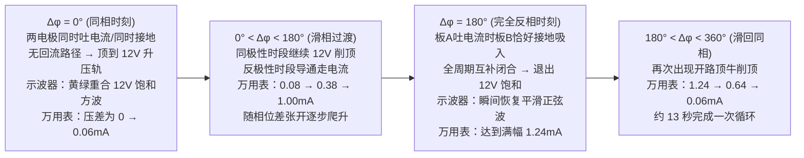
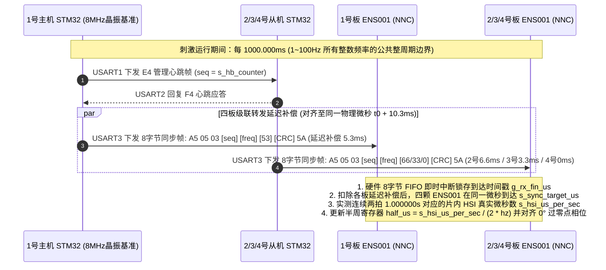

# 四板叠加跨通道刺激电流跳变根因分析与串口晶振锁相（UART-DPLL）修复说明

> **更新日期**：2026-11-23  
> **涉及工程**：
> - 刺激芯片固件（`ENS001 / NNC6121`）：`EEG_NNC`（GitHub 仓库：`https://github.com/grhjgt/NNC-LinuxPC.git`）
> - 主机固件（1 号板 `STM32F103RCT6`）：`Sleep_Master`（GitHub 仓库：`https://github.com/grhjgt/Sleep_Master.git`）
> - 从机固件（2/3/4 号板 `STM32F103RCT6`）：`Sleep_Slave`（GitHub 仓库：`https://github.com/grhjgt/Sleep_Slave.git`）

---

## 目录

1. [问题背景与实测现象对比](#1-问题背景与实测现象对比)
2. [竞品脑电刺激帽的工作原理揭秘](#2-竞品脑电刺激帽的工作原理揭秘)
3. [我方四板开发板跨路电流跳变与方波失真的物理根因](#3-我方四板开发板跨路电流跳变与方波失真的物理根因)
4. [无飞线纯软件解决方案：串口数字锁相环（UART-DPLL）](#4-无飞线纯软件解决方案串口数字锁相环uart-dpll)
5. [冷机无电流与台架测试开路切输出问题一并修复](#5-冷机无电流与台架测试开路切输出问题一并修复)
6. [同频刺激与异频刺激（如 10Hz + 15Hz）的物理边界说明](#6-同频刺激与异频刺激如-10hz--15hz的物理边界说明)
7. [涉及文件改动清单与协议规范](#7-涉及文件改动清单与协议规范)
8. [现场烧录与台架复测指南](#8-现场烧录与台架复测指南)

---

## 1. 问题背景与实测现象对比

在相同的台架测试环境下（使用 $500\,\Omega$ 负载电阻与 Fluke 真有效值万用表串联，配合 Keysight 示波器观察两端波形），对比测试竞品 tACS 脑电刺激设备与我方 4 板叠加开发板（1 主 3 从，共 4 路 8 电极），观察到如下差异：

| 测试项 | 竞品脑电刺激产品（设置 `10Hz, 0.8mA`） | 我方 4 板开发板修复前（设置 `10Hz, 1.1mA`） |
| :--- | :--- | :--- |
| **单路内测量**（如 `1-2`、`3-4`、`5-6`、`7-8`） | 稳定导通，恒为 `0.28 mA` 正弦交流电 | 稳定导通，四路各自均为稳定的 `1.1 mA`（万用表约 `1.23 mA`）正弦交流电 |
| **跨路「奇数 ↔ 偶数」测量**（如 `1-4`、`1-6`、`3-8`） | 稳定导通，恒为 `0.28 mA` 正弦交流电 | **异常**：导通，但电流在 `0.06 mA ~ 1.24 mA` 之间以约 **13 秒**为周期反复递增、递减；平时示波器呈 `12V` 饱和方波，**仅在升到峰值瞬间短暂变成正弦波** |
| **跨路「奇数 ↔ 奇数」或「偶数 ↔ 偶数」**（如 `1-3`、`2-4`） | **完全不导通（`0 mA`）** | **异常**：同样导通，且同样在 `0.06 mA ~ 1.24 mA` 之间周期性反复增减 |
| **参考电极 `R1 / R2` 测量** | `1~8` 与 `R1`、`R2` 均导通（`0.28 mA`）；`R1` 与 `R2` 之间不导通 | 无独立 `R1/R2` 刺激参考电极 |

---

## 2. 竞品脑电刺激帽的工作原理揭秘

竞品并不是“4 路电气隔离的独立刺激器”，而是典型的**「共参考地（Common Reference）+ 同源时钟严格锁相（奇偶 $180^\circ$ 反相）」**架构：

### 2.1 为什么奇数只通偶数和 `R1/R2`，而奇奇、偶偶、`R1-R2` 不通？
竞品将 10 个电极划分为三个内部等电位/同相簇：
1. **奇数电极组 `{1, 3, 5, 7}`（正相组，相位锁定为 $0^\circ$）**：
   全部由同一个时钟源驱动输出正相正弦电流 $+I_0\sin(\omega t)$。在任意时刻 $t$，任意两个奇数电极的电位完全相等（$V_{\text{奇1}}(t) \equiv V_{\text{奇2}}(t)$），**电位差 $\Delta V(t) \equiv 0$，因此奇数与奇数之间无电流（不导通）**。
2. **偶数电极组 `{2, 4, 6, 8}`（反相组，相位锁定为 $180^\circ$）**：
   全部输出反相正弦电流 $-I_0\sin(\omega t)$。偶数电极彼此之间相位也完全相同（同为 $180^\circ$），任意两个偶数电极之间的电位差同样恒为 $\Delta V(t) \equiv 0$，**因此偶数与偶数之间也不导通**。
3. **参考电极组 `{R1, R2}`（公共参考地 `REF / GND`）**：
   位于左右耳前颞部，内部接在竞品主板的公共参考地（或中点基准地）上，本身无驱动源，因此 **`R1` 与 `R2` 之间无电势差、互不导通**。

### 2.2 为什么设了 `0.8mA`，测出来全是稳定的 `0.28mA`？
* **峰峰值与有效值（RMS）换算**：
  竞品软件界面设定的 `0.8 mA` 定义为**正弦波峰峰值 $I_{\text{p-p}} = 0.8\text{ mA}$**（即正负峰值幅度 $I_{\text{peak}} = \pm 0.4\text{ mA}$）。万用表交流毫安档测量的是正弦波的**真有效值（RMS）**：
  $$I_{\text{RMS}} = \frac{I_{\text{p-p}}}{2\sqrt{2}} = \frac{0.8\text{ mA}}{2.8284} = \mathbf{0.2828\text{ mA}} \approx \mathbf{0.28\text{ mA}}$$
* **为什么「奇/偶 ↔ R1/R2」和「奇 ↔ 偶」电流相同？**
  * 测 **奇（或偶）↔ `R1/R2`** 时：单端恒流源经 $500\,\Omega$ 电阻流回公共参考地 `R1/R2`，电流为 `0.28 mA`；
  * 测 **奇 ↔ 偶**（其余电极悬空）时：奇数端恒流源在正半周**吐出** $+I(t)$ 的同一瞬间，偶数端恒流源因严格 $180^\circ$ 反相，恰好向公共地**吸入** $-I(t)$。两个同幅反相的恒流源串联在同一个 $500\,\Omega$ 负载两端时，回路电流不会翻倍，依然严格等于恒流源设定值 `0.28 mA`。

---

## 3. 我方四板开发板跨路电流跳变与方波失真的物理根因

### 3.1 根因一：为什么我方 8 个电极任意两两之间都导通？—— 四板共地（Common GND）
我方 4 块开发板（1 主 3 从）通过级联串口线和电源地线（`GND`）连接在一起。每块板上 `ENS001 (NNC6121)` 刺激芯片的高压升压轨（`BOOST_CTRL = 0x77213`，约 `12V~15V`）与 H 桥低端开关（`WAVE_GEN_DRVC_BLK5`）全部以各自板子的 `GND` 为基准。
当 4 块板共地后，电流可以从 `板A电极 → 500Ω电阻 → 板B电极 → 板B内部GND → 板间共地线 → 板A内部GND` 构成完整闭合回路，因此跨板任意电极之间均存在导电通路。

### 3.2 根因二：为什么跨路电流在 `0.06mA ↔ 1.24mA` 之间反复增减，且平时是方波、仅在峰值瞬间出正弦波？—— 四颗 `ENS001` 内部异步 RC 时钟频差导致拍频（滑相效应）
修复前，主机与从机在 `NNC_Sync_Params()` 中下发给 `ENS001` 的 `0x02` 参数帧第 5 字节固定为 `0x00`（未启用外部时钟），导致 4 块板上的 4 颗 `ENS001` 全部运行在**各自独立的内部 32MHz RC 振荡器（HSI）**上。

不同芯片的内部 RC 振荡器存在约 $0.5\% \sim 1\%$ 的天然频偏。例如同样设置 `10 Hz`：
* 板 1 的实际输出频率为 $f_1 = 10.000\text{ Hz}$；
* 板 2 的实际输出频率为 $f_2 = 10.077\text{ Hz}$（频差 $\Delta f \approx 0.077\text{ Hz}$，即 $0.77\%$）。

这 $0.077\text{ Hz}$ 的频差，导致两块板输出波形之间的**实时相位差 $\Delta\phi(t) = 2\pi \Delta f \cdot t$ 以 $T = \frac{1}{\Delta f} \approx 13\text{ 秒}$ 为周期，不断在 $0^\circ \to 180^\circ \to 360^\circ$ 之间循环滑动**：

1. **当滑到 $\Delta\phi = 0^\circ$（同相重合时刻）**：
   两个电极在前半周（50ms）**同时连接到高压端恒流源向外吐电流**，后半周（50ms）**同时切换到 GND**。由于两块板各自的另一根配对电极悬空，两个同相吐电流的恒流源找不到回地路径（开路顶牛），输出电压瞬间饱和顶到最高升压轨（约 `12V`），下半周又同时回到 `0V`，因此在示波器上呈现**黄绿完全重合的 `12V` 饱和方波**。此时 $500\,\Omega$ 电阻两端电位相等（$\Delta V \approx 0$），万用表电流跌至谷底（`0.06 ~ 0.08 mA`）。
   > **注**：竞品的“奇测奇”、“偶测偶”之所以永远是 `0 mA`，正是因为竞品把同组电极永久锁死在了 $\Delta\phi = 0^\circ$ 同相状态。
2. **当滑到 $\Delta\phi = 180^\circ$（完全反相时刻）**：
   板 A 电极处于正半周吐出 $+I\sin(\omega t)$ 的每一瞬间，板 B 电极恰好处于负半周切换到 `GND` 吸入电流；后半周反之。两个恒流桥在整个 $360^\circ$ 周期内完美互补闭合，退出 `12V` 电压饱和，恢复正常恒流调节（压降 $= I(t) \times 500\,\Omega$）。因此**示波器上的饱和方波在峰值瞬间立刻变成干净的正弦波，万用表电流也达到设定满幅（`1.21 ~ 1.24 mA`）**。
   > **注**：竞品的“奇测偶”之所以永远是稳定的正弦波，正是因为竞品把奇偶两组永久锁死在了 $\Delta\phi = 180^\circ$ 反相状态。

---

## 4. 无飞线纯软件解决方案：串口数字锁相环（UART-DPLL）

在不改动硬件、不增加任何飞线的前提下，利用**每块板 `STM32F103RCT6` 已有的高精度 `8MHz` 外部石英晶振（`HSE`，精度 $\pm 10\sim 20\text{ ppm}$）**和**现有的两级串口链路（主从板间 `USART1/2` + 板内 `USART3`）**，在固件中实现了**「串口数字锁相环（UART-DPLL）」**。

### 4.1 整体架构与同步时序

### 4.2 关键技术设计细节

1. **8 字节定长同步信标帧（零 FIFO 超时抖动）**：
   * `ENS001` 的 `UART1` 接收 FIFO 触发阈值配置为 `bytes_8`（8 字节触发 `INT_RCV_DATA_AVAILABLE` 中断，不足 8 字节需等待 4 个字符时间的 `INT_CHAR_TIMEOUT_INDICATION` 超时）。
   * 新增 `CMD = 0x05` 同步信标帧，严格设计为 **8 字节**：
     `A5 05 03 [sync_seq] [freq_hz] [delay_100us] [CRC8] 5A`
   * 当第 8 字节 `0x5A` 停止位到达瞬间，立即触发 `UART1_Handler` 中断并锁存微秒级时间戳 `g_rx_fin_us = get_hsi_us()`，消除了主循环轮询延迟和 FIFO 超时延迟。
2. **与 `WAVE_GEN` 同源的 $1\text{ }\mu\text{s}$ 高精度计时器 `get_hsi_us()`**：
   * `ENS001` 的波形发生器配置为 `WAVE_GEN_DRV_CLK_FREQ_REG = 0x20`（即 `HSI 32MHz / 32 = 1MHz`，每步 $1\text{ }\mu\text{s}$）。
   * `get_hsi_us()` 结合 `10kHz` 的 `SysTick` 计数 `g_tick_100us` 与 `SysTick->VAL` 递减寄存器（`(load - val) >> 5`，同样是 `HSI / 32`），提供与硬件波形发生器 **100% 同源同频的 $1\text{ }\mu\text{s}$ 时间基准**。
3. **片内 RC 振荡器频偏自动测量与校准（锁频）**：
   * 当收到连续两拍同步信标（`(uint8_t)(seq - last_seq) == 1`）时，用 `dt_us = s_sync_target_us - s_sync_last_target_us` 实测主机 `8MHz` 石英晶振 `1.000000 秒` 对应的本片 `HSI` 真实微秒数 `s_hsi_us_per_sec`（例如某片 RC 偏快 $+0.77\%$ 时测出 `1,007,700`）。
   * 将正负半周期寄存器动态修正为：
     $$\text{half\_us} = \frac{s\_hsi\_us\_per\_sec + \text{hz}}{2 \times \text{hz}}$$
     （如 `10Hz` 下自动由默认的 `50000` 修正为 `50385`），使 4 块板输出的真实物理频率严格收敛至 `10.0000 Hz`（$\Delta f \equiv 0$）。
4. **四板级联延迟补偿与整秒过零点相位锁定（锁相）**：
   * 在 `115200 bps` 级联串口下，主机依次向 2、3、4 号从机发送 `E4` 心跳帧，各板收到心跳并转发的时间存在固定的毫秒级级联差。
   * 各板通过 `delay_100us` 参数下发补偿值（2 号板 `66` = `6.6ms`，1 号主机 `53` = `5.3ms`，3 号板 `33` = `3.3ms`，4 号板 `0` = `0.0ms`），使 4 颗 `ENS001` 的 `s_sync_target_us` 对齐到同一物理微秒。
   * 由于 `1.000000 秒` 恰好包含整数个正弦周期（$1\text{ s} = \text{hz} \times T$），经过频偏校准的正弦波在每 `1.000000 秒` 结束时刻恰好走完第 $\text{hz}$ 个周期的末尾（`sine_data[63] = 0x00`，即电流为 `0 mA` 的 $0^\circ$ 过零点），此时四板同步重锁过零点相位，既无波形突变毛刺，又彻底消除了任何跨秒累积相位漂移。

---

## 5. 冷机无电流与台架测试开路切输出问题一并修复

在本次 `EEG_NNC` 固件更新中，同时修复了以下两个影响现场测试的问题：

1. **修复冷机首次开机无刺激电流 Bug**：
   * **原因**：旧版 `LOD_Init()` 中执行了 `WAVE_GEN_DRVC_BLK5->WAVE_GEN_DRV_CTRL_REG &= ~1u;`，将配对通道的低端回路驱动器 Driver C 关断，导致冷机上电后第一次开启刺激时电流回路不通。
   * **修复**：在 `LOD_Init()` 中移除对 `COMP0_CTRL` 和 `WAVE_GEN_DRVC_BLK5 / BLK7` 的关断操作。
2. **对齐主控脱落保护开关，避免台架换夹子/空载时自切输出**：
   * **原因**：主机 `Sleep_Master` 已于 `9d9c362` 将 `NNC_LOD_ENABLE` 设为 `0`（停用开路回待机），但 `EEG_NNC` 内部 `LOD_Proc()` 在检测到开路 2 个窗口后仍会调用 `lod_cut_output()` 关断自身 `WAVE_GEN_DRVA_BLK0` 输出，导致台架跨路测试拔插电阻夹子时刺激被悄悄切断。
   * **修复**：在 `EEG_NNC/USER/mian.c` 中新增 `#define LOD_CUT_ENABLE 0`（默认 `0` 与主控对齐，需要恢复硬件自切时改回 `1` 即可）。

---

## 6. 同频刺激与异频刺激（如 10Hz + 15Hz）的物理边界说明

| 应用场景 | 固件锁相后的表现 | 物理原理说明 |
| :--- | :--- | :--- |
| **四通道同频刺激** （如 4 路均为 `10Hz` 或均为 `40Hz`） | **彻底解决（与竞品完全一致）**： - 单路内：稳定设定电流正弦波 - 跨路「奇 ↔ 偶」：稳定设定电流正弦波，不再在 `0~1.1mA` 间起伏 - 跨路「奇 ↔ 奇 / 偶 ↔ 偶」：恒为 `~0 mA`（不导通） | 4 块板锁定在同一频率（$\Delta f = 0$）和同一相位（$\Delta\phi = 0^\circ$），所有奇数电极同相涨落、所有偶数电极反相涨落，共地网络下无跨路顶牛。 |
| **四通道异频刺激 —— 单路独立测量** （如 `1-2` 设 `10Hz`，`3-4` 设 `15Hz`，分别测 `1-2` 和 `3-4`） | **正常工作且频率更准**： - `1-2` 为精准的 `10.000 Hz` 稳定正弦波 - `3-4` 为精准的 `15.000 Hz` 稳定正弦波 | `1.000000 秒` 是 `10Hz`（10 个周期）和 `15Hz`（15 个周期）的公共整周期边界，每秒同步点处两路均恰好位于各自的 $0^\circ$ 过零点（`0 mA`），互不冲突。 |
| **四通道异频刺激 —— 跨接不同频率电极** （如拿一只电阻一头夹 `10Hz` 的 `1`，另一头夹 `15Hz` 的 `4`） | - 万用表：读数基本稳定在混频有效值（不再出现 13 秒慢周期归零） - 示波器：呈现 $\Delta f = 15 - 10 = 5\text{ Hz}$（周期 `200ms`）的混频包络 | 不同频率的两个交流源（`10Hz` 与 `15Hz`）天然存在 `5Hz` 频率差，无法在共地条件下锁成恒定反相。若未来临床要求在同一头皮上同时施加不同频率且完全无跨路串流，硬件上必须在板间增加串口隔离（`ADuM1201`）+ 电源隔离（`B0505S`）以断开四板共地。 |

---

## 7. 涉及文件改动清单与协议规范

### 7.1 `USART3` 新增同步信标协议（`CMD = 0x05`）

| 字节序号 | 字段 | 取值 | 说明 |
| :---: | :---: | :---: | :--- |
| 0 | `Header` | `0xA5` | 固定帧头 |
| 1 | `CMD` | `0x05` | 1s 晶振同步与锁相信标命令 |
| 2 | `LEN` | `0x03` | 数据载荷长度（固定 3 字节，整帧 8 字节以触发 `UART1` 8 字节 FIFO 中断） |
| 3 | `DATA[0]` | `seq` | 连续递增的 1s 秒拍序号（`0~255` 回绕），用于判断连续 `1.000000s` 间隔 |
| 4 | `DATA[1]` | `freq_hz` | 当前刺激频率（`1~100 Hz`） |
| 5 | `DATA[2]` | `delay_100us` | 板间级联延迟补偿（单位：$100\text{ }\mu\text{s}$；主机=`53`，2号=`66`，3号=`33`，4号=`0`） |
| 6 | `CRC8` | `crc` | `CRC8(Byte[0..5])`，多项式 `0x07` |
| 7 | `Tail` | `0x5A` | 固定帧尾 |

### 7.2 代码修改位置对照表

| 工程 | 文件路径 | 修改内容摘要 |
| :--- | :--- | :--- |
| **NNC-LinuxPC (`EEG_NNC`)** | `FWLIB/source/ENS1_UART.c` | 在 `UART1_Handler` 收齐帧置 `rev_fin = 1` 瞬间记录 `g_rx_fin_us = get_hsi_us()` |
| **NNC-LinuxPC (`EEG_NNC`)** | `USER/mian.c` | 新增 `get_hsi_us()`、`wavegen_sync_proc()`、`CMD=0x05` 解析；修复 `LOD_Init` 冷机无电流；新增 `LOD_CUT_ENABLE=0` |
| **Sleep_Master (主机)** | `Core/Inc/bsp_nnc.h` `Core/Src/bsp_nnc.c` `Core/Src/stim_task.c` | 新增 `NNC_Send_SyncPulse()`；在 `HeartbeatTick()` 无漂移 1s 节拍与旧模式 1s 倒计时中下发同步信标 |
| **Sleep_Slave (从机)** | `Core/Inc/bsp_nnc.h` `Core/Src/bsp_nnc.c` `Core/Src/stim_node.c` | 新增 `NNC_Send_SyncPulse()`；在 `handle_heartbeat()` 收到 `E4` 心跳时按板号延迟补偿下发同步信标（已同步合入 `NiSleep_Pro_Slave` 主分支与 `test/slave2-shutdown-diag` 测试分支） |

---

## 8. 现场烧录与台架复测指南

1. **烧录 4 块板的 `ENS001 (NNC6121)` 刺激芯片**：
   * 打开 `EEG_NNC/ENS001_BASIC_PRJ.uvprojx`，将编译生成的 `Objects/ENS001_BASIC_PRJ.hex`（或 `Bin/ENS001_BASIC_PRJ.bin`）依次烧录到 4 块开发板的 `ENS001` 芯片中。
2. **烧录 1 号主机 `STM32F103`**：
   * 打开 `Sleep_Master-NiSleep_Pro_Master/MDK-ARM/EEG.uvprojx`，烧录 `MDK-ARM/EEG/EEG.hex`。
3. **烧录 2、3、4 号从机 `STM32F103`**：
   * 打开 `Sleep_Slave-NiSleep_Pro_Slave/MDK-ARM/EEG.uvprojx`；
   * 在 `Core/Inc/bsp_esp.h` 中将 `#define SLAVE_DEV_ID_FIXED` 分别设为 `2`、`3`、`4`，依次编译并烧录到 2、3、4 号从机。
4. **台架复测验证**：
   * 将 4 块板的**同极性输出端统一编号为奇数电极（`1, 3, 5, 7`）**，**另一极性输出端统一编号为偶数电极（`2, 4, 6, 8`）**；
   * 启动四路 `10Hz, 1.1mA` 刺激，等待 **2 秒**（完成首次测频与过零锁相）；
   * 用万用表串联 $500\,\Omega$ 电阻跨接任意「奇数 ↔ 偶数」电极（如 `1-4`、`1-6`、`3-8`），可观察到示波器全程输出稳定不滑动的正弦波，万用表电流稳定保持在设定值，不再出现周期性归零与方波削顶。
